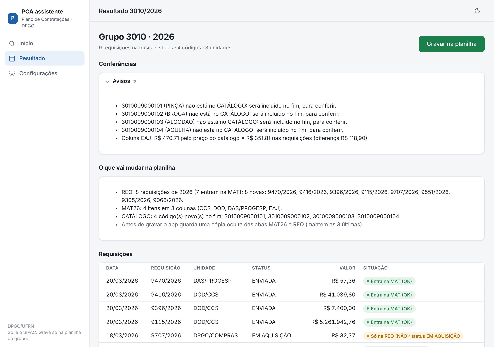

# PCA Assistente

Ferramenta que busca no **SIPAC** as requisições de material de um grupo e monta automaticamente a planilha do
**Plano de Contratações Anual (PCA)** no Google Sheets ou em .xlsx. Substitui horas de cópia manual por uma
busca, uma conferência e um clique.

> Versão pública para portfólio. As imagens e os testes usam **dados fictícios** (SIPAC simulado e planilha em
> memória). Credenciais ficam só na máquina do usuário e nunca no repositório.



## Como funciona

1. **Busca**: lê as requisições do grupo/ano no SIPAC (só leitura), via Playwright ligado ao Chrome do usuário.
2. **Montagem**: agrega por código e unidade, cruza com o CATÁLOGO e calcula a matriz (`montagem.py`).
3. **Conferência**: mostra avisos (código fora do catálogo, divergência de preço) e uma prévia do que vai mudar.
4. **Gravação**: grava só na planilha do grupo, preservando as colunas manuais e guardando cópias de segurança
   em abas ocultas (mantém as 3 últimas).

## Destaques técnicos

- Parsers de HTML do SIPAC testados com fixtures (`parsers.py`, `tests/fixtures/`).
- Saídas intercambiáveis: Google Sheets (conta de serviço ou OAuth) e .xlsx (`saida.py`, `saida_xlsx.py`).
- Interface web local (FastAPI + Jinja2) com tarefa em segundo plano, progresso ao vivo e botão Parar.
- Empacotamento para Windows com PyInstaller e um instalador de um clique (`scripts/`).
- 81 testes, incluindo um SIPAC simulado de ponta a ponta.

## Rodar a demonstração (sem SIPAC nem Google)

```bash
uv run python scripts/demo.py
```

Depois abra http://127.0.0.1:8011/.

```bash
uv run --with pytest pytest -q
```

## Stack

Python 3.12 · Playwright · FastAPI · gspread / Google API · openpyxl · PyInstaller · pytest · uv

Guia do usuário final: [LEIA-ME.md](LEIA-ME.md).
